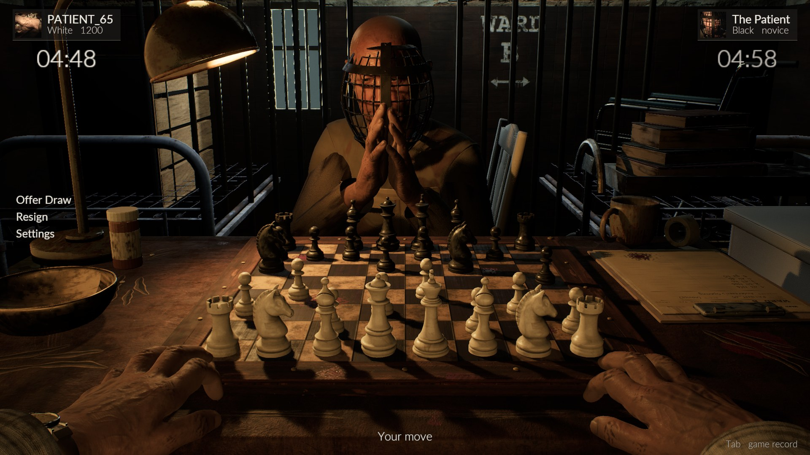
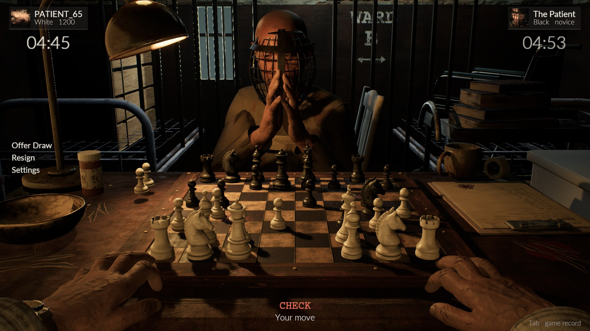
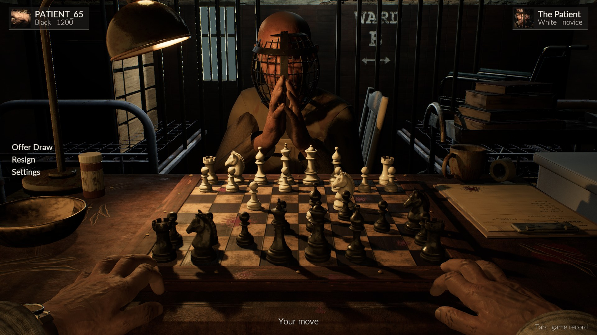
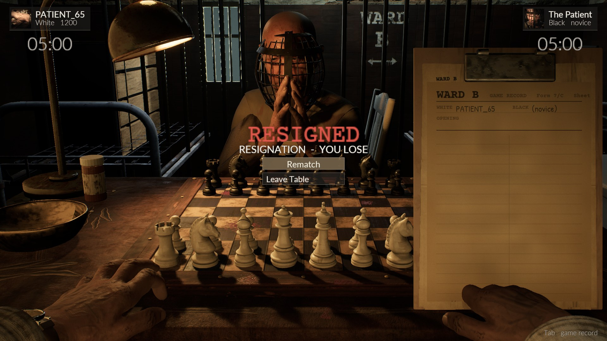
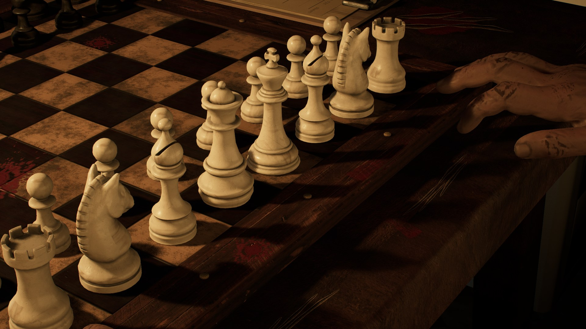
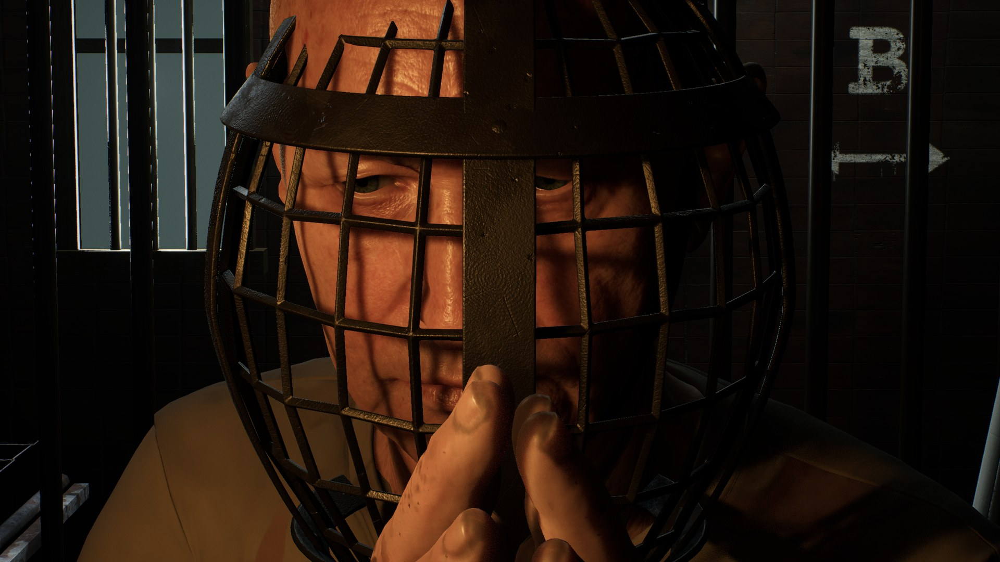
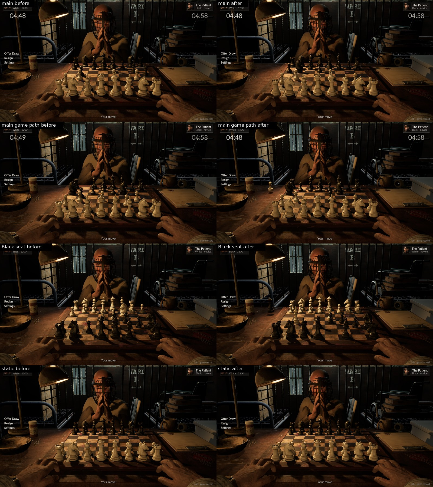
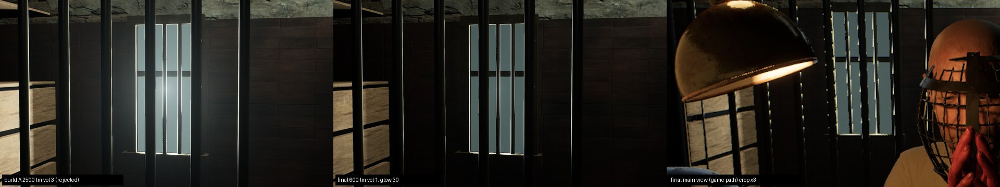
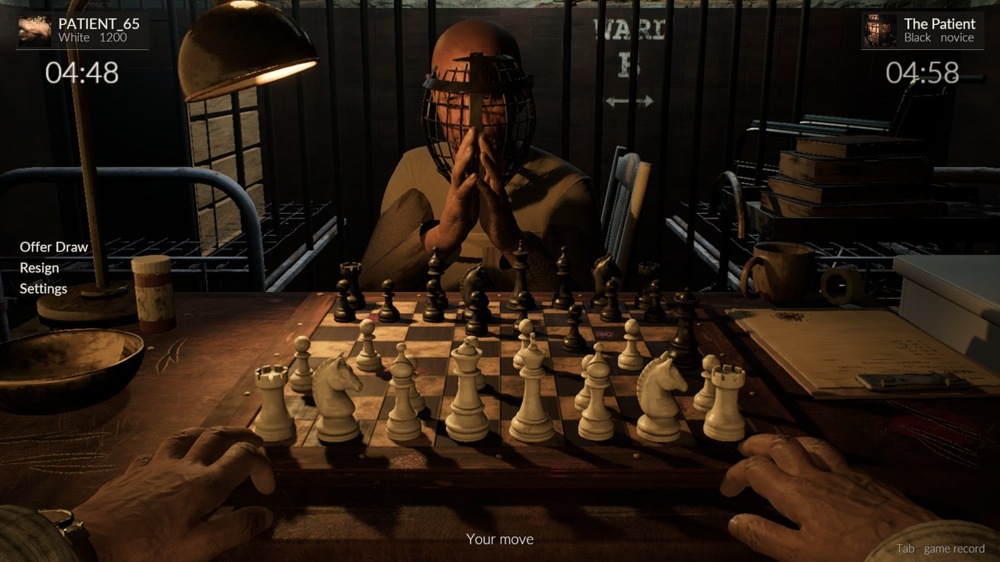
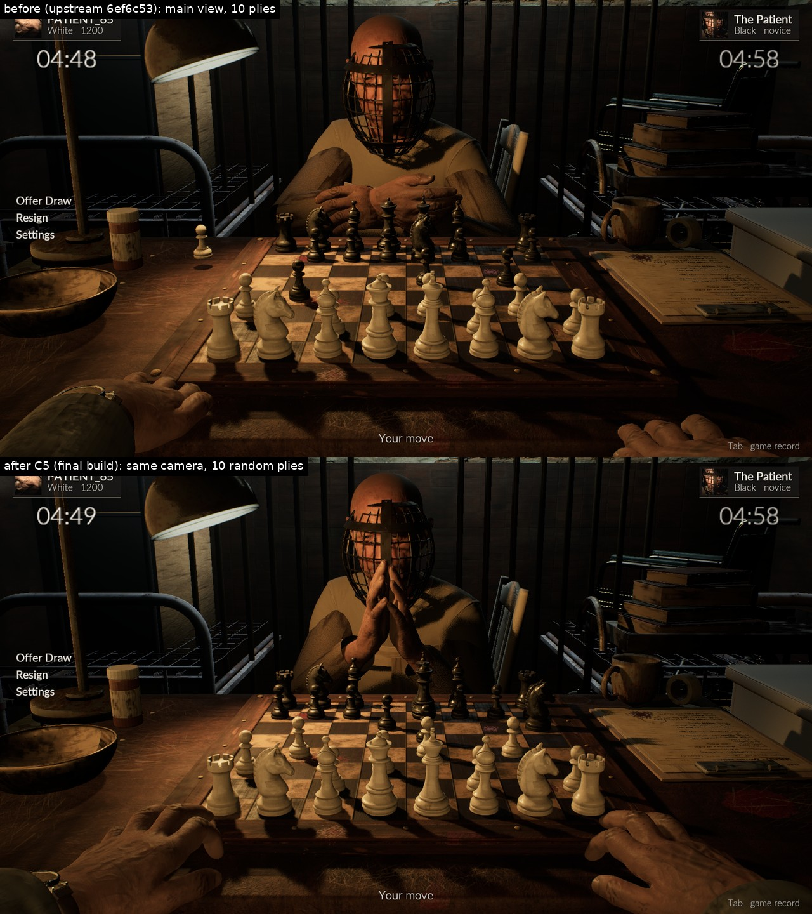

# TownChess screenshots

Gameplay captures from the native UE 5.8 build on the Windows build PC (RTX 4070 Ti SUPER), updated by the lead at
each milestone. Newest first. Captures marked "game path" render exactly what the player sees (Epic, 83% screen
percentage upscaled by TSR); close-ups render at full resolution. The reference these are judged against is
[docs/reference/concept-reference.jpg](../reference/concept-reference.jpg).

## Latest

**2026-10-16, build b847d2d** (passed the full QA gate: all autotests, 10/10 long games, reconnect; 81 fps avg / 73 fps 1% low at 1440p Epic, offscreen). 2560x1440 captures, shown at 1920x1080; main, midgame, Black seat and end card on the game path with the HUD.

| | |
|---|---|
| Opening, White seat (game path, HUD) |  |
| Midgame |  |
| Black seat |  |
| End card after resigning (game record clipboard) |  |
| Close-up: player's hand and the white pieces |  |
| Close-up: the caged patient |  |

Most recent work in progress (graphics passes, before/after on the same camera):

| Pass | Image |
|---|---|
| C8m materials: filthy patient gown, skin roughness from dirt, wood gouges |  |
| C9 lighting: cold barred window in view |  |
| C8b room: WARD B sign, lamp, clipboard (game path) |  |
| C5 hands: pose calibrated to the mesh, fingertips on the table |  |
